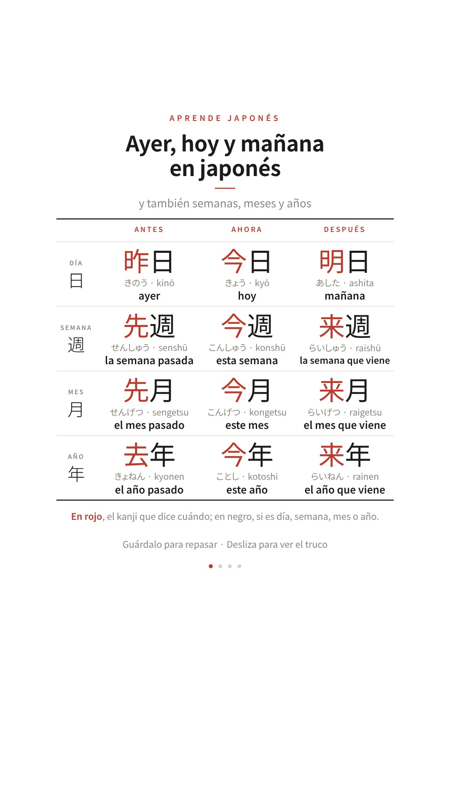
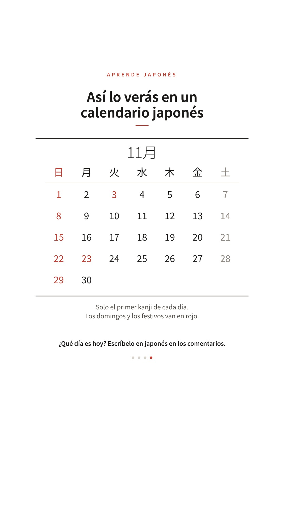
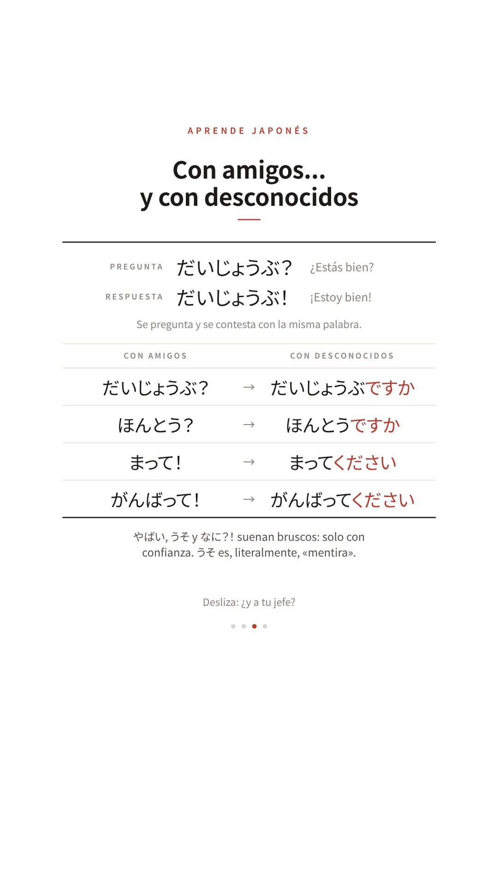
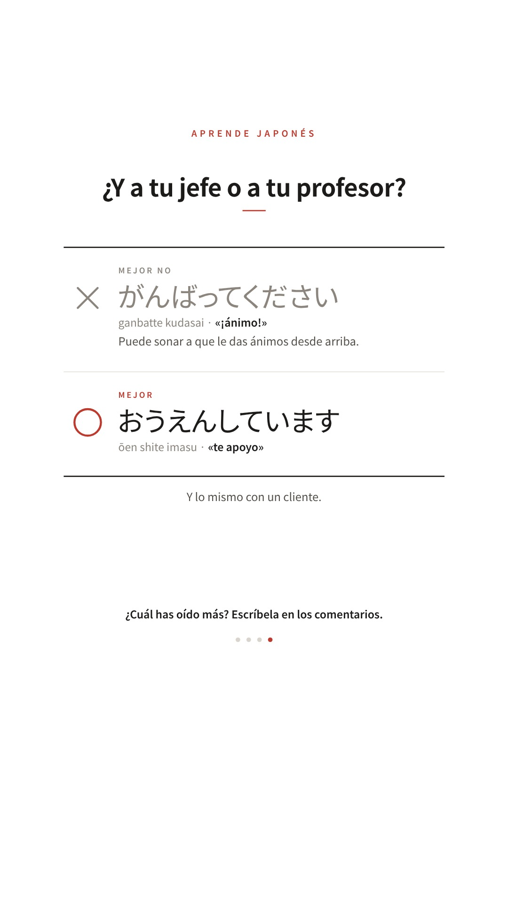

# TikTok desde el móvil: láminas y vídeo de だいじょうぶ

Instagram y YouTube salen solos desde Buffer. Esto es solo para TikTok.

TikTok solo sube lo que está en la galería del móvil, no acepta enlaces. Así que cada pieza pasa por el móvil solo un momento: la guardas, la subes y la borras.

## Cómo se sube

1. Abre esta página en Safari.
2. Guarda la pieza del día:
   - **Imágenes**: toca cada una para abrirla en grande, mantén el dedo encima y elige «Añadir a Fotos». Guárdalas en orden: 1, 2, 3 y 4.
   - **Vídeo**: toca el enlace y, cuando se abra, pulsa compartir (el cuadrado con la flecha) y luego «Guardar vídeo».
3. En TikTok, pulsa **+** y luego **Subir**. Elige las cuatro fotos en orden, o el vídeo. Si te deja elegir entre foto y vídeo, elige **Foto**.
4. Copia el título y la descripción de cada bloque gris de abajo. Cada bloque tiene un botón para copiar.
5. En «Más opciones», activa **Contenido generado por IA**.
6. Publica. Después, borra las fotos o el vídeo de Fotos, y también del álbum «Eliminado».

---

## Jueves 19 · 17:00 · Ayer, hoy y mañana

<a href="https://raw.githubusercontent.com/Jaimeulises/michi-videos/laminas/laminas/cuando/tt/01.jpg"></a>
<a href="https://raw.githubusercontent.com/Jaimeulises/michi-videos/laminas/laminas/cuando/tt/02.jpg"></a>
<a href="https://raw.githubusercontent.com/Jaimeulises/michi-videos/laminas/laminas/cuando/tt/03.jpg"></a>
<a href="https://raw.githubusercontent.com/Jaimeulises/michi-videos/laminas/laminas/cuando/tt/04.jpg"></a>

Título:

```
Ayer, hoy y mañana en japonés 📅
```

Descripción:

```
Ayer, hoy y mañana en japonés, y el truco 先 · 今 · 来 para semanas y meses. Láminas hechas con IA. #aprenderjapones #japones #kanji #nihongo #japonesparaprincipiantes
```

---

## Viernes 20 · 17:00 · Los días de la semana

<a href="https://raw.githubusercontent.com/Jaimeulises/michi-videos/laminas/laminas/semana/tt/01.jpg"></a>
<a href="https://raw.githubusercontent.com/Jaimeulises/michi-videos/laminas/laminas/semana/tt/02.jpg"></a>
<a href="https://raw.githubusercontent.com/Jaimeulises/michi-videos/laminas/laminas/semana/tt/03.jpg"></a>
<a href="https://raw.githubusercontent.com/Jaimeulises/michi-videos/laminas/laminas/semana/tt/04.jpg"></a>

Título:

```
Los días de la semana en japonés 🌙
```

Descripción:

```
Los días de la semana en japonés y su secreto: de lunes a viernes, los mismos astros que en español. Láminas hechas con IA. #aprenderjapones #japones #kanji #nihongo #culturajaponesa
```

---

## Sábado 21 · 17:00 · Vídeo de だいじょうぶ

**[Abrir el vídeo (34 s)](https://raw.githubusercontent.com/Jaimeulises/michi-videos/laminas/momo/momo-04-daijobu.mp4)**

Descripción:

```
La misma palabra para preguntar y para contestar en japonés 🩹 #aprenderjapones #japones #japonesparaprincipiantes #nihongo #culturajaponesa
```

---

## Sábado 21 · 17:30 · 8 palabras que oyes en cualquier anime

<a href="https://raw.githubusercontent.com/Jaimeulises/michi-videos/laminas/laminas/anime/tt/01.jpg"></a>
<a href="https://raw.githubusercontent.com/Jaimeulises/michi-videos/laminas/laminas/anime/tt/02.jpg"></a>
<a href="https://raw.githubusercontent.com/Jaimeulises/michi-videos/laminas/laminas/anime/tt/03.jpg"></a>
<a href="https://raw.githubusercontent.com/Jaimeulises/michi-videos/laminas/laminas/anime/tt/04.jpg"></a>

Título:

```
8 palabras que oyes en cualquier anime 🎌
```

Descripción:

```
8 palabras que oyes en cualquier anime, y cuál no le dirías a tu jefe. Láminas hechas con IA. #aprenderjapones #japones #anime #nihongo #japonesparaprincipiantes
```
