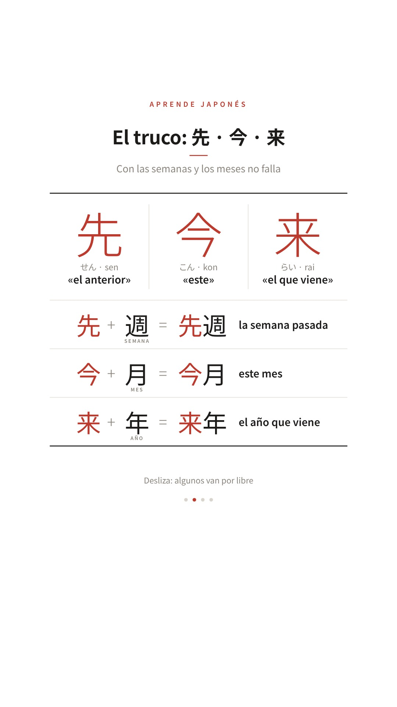
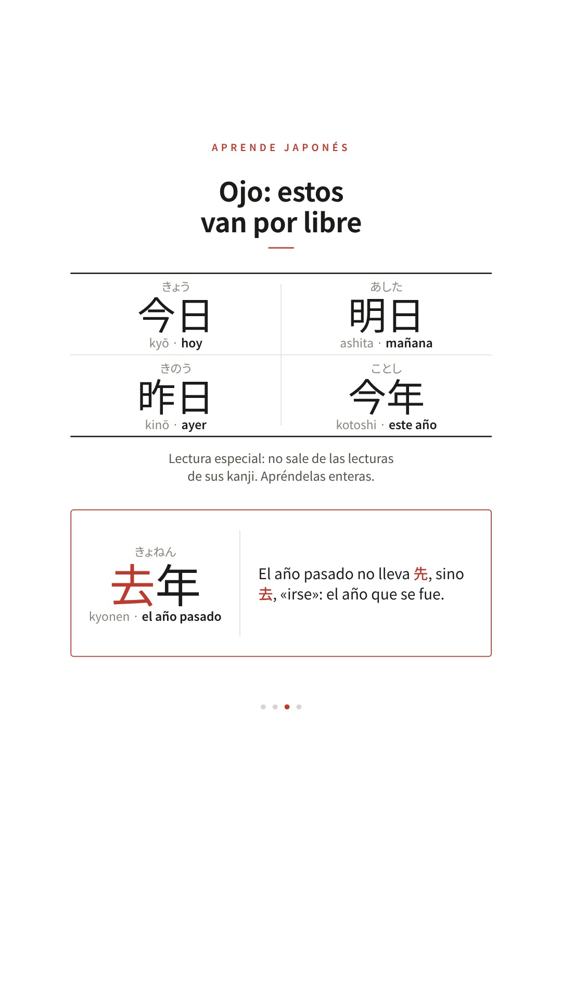
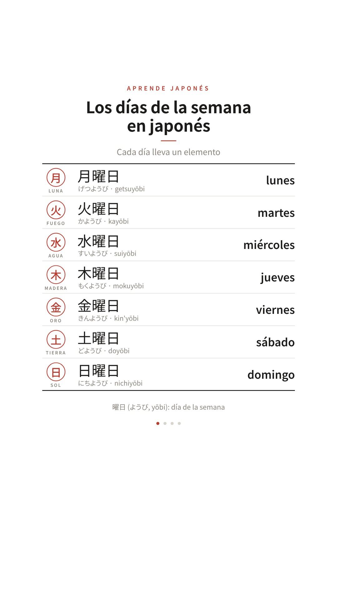
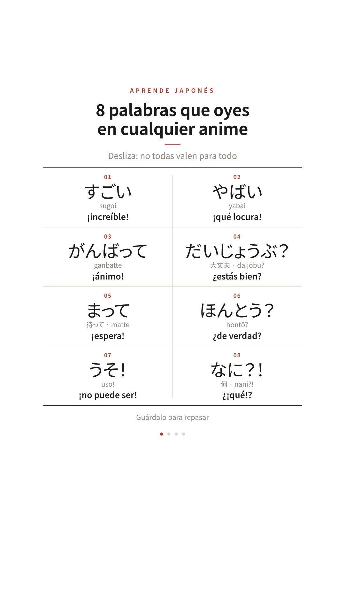

# TikTok desde el móvil

Instagram y YouTube salen solos desde Buffer. TikTok lo subes tú desde el móvil: desde el 16 de noviembre no sale nada en TikTok por Buffer.

TikTok solo sube lo que está en la galería del móvil, no acepta enlaces. Así que cada pieza pasa por el móvil solo un momento: la guardas, la subes y la borras.

## Cómo se sube

1. Abre esta página en Safari.
2. Guarda la pieza del día:
   - **Imágenes**: toca cada una para abrirla en grande, mantén el dedo encima y elige «Añadir a Fotos». Guárdalas en orden.
   - **Vídeo**: toca el enlace y elige «Descargar». Después toca la flecha de descargas, arriba en Safari, abre el vídeo, pulsa compartir (el cuadrado con la flecha) y elige «Guardar vídeo». Al final, bórralo también de Archivos, en «Descargas».
3. En TikTok, pulsa **+** y luego **Subir**. Elige las fotos en orden, o el vídeo. Si te deja elegir entre foto y vídeo, elige **Foto**.
4. Copia el título (solo en las fotos) y la descripción de cada bloque gris de abajo. Cada bloque tiene un botón para copiar.
5. Portada de los vídeos: el primer segundo, con la pregunta o el título.
6. En «Más opciones», activa **Contenido generado por IA**.
7. Publica. Después, borra las fotos o el vídeo de Fotos, y también del álbum «Eliminado».

En Instagram las piezas salen a las 17:00. En TikTok, súbelas a la hora que te venga bien, una al día.

**Pausa desde el 17 de noviembre.** Solo sale lo que tiene fecha confirmada: ahora mismo, las prefecturas (publicadas el miércoles 18), Momo 07 (publicado el jueves 19 por la mañana), Momo 10 (viernes 20) y los tres vídeos con el libro (desde el sábado 21, uno al día). Los cinco vídeos nuevos para ganar seguidores (23 de noviembre) están más abajo, en su sección. Lo demás de los días 19 a 23 sigue en pausa hasta que digas desde cuándo retomar.

---

## Ya · Momo 02 · Al llegar a casa

El que más vistas tuvo en Instagram. Es la versión corregida: «¡Ya estoy aquí!» y «¡Ya estás aquí!».

**[Descargar el vídeo (32 s)](https://raw.githubusercontent.com/Jaimeulises/michi-videos/primera-tanda/primera-tanda/momo-02-casa-youtube.mp4)**

Descripción:

```
Lo que se dice en Japón al llegar a casa 🏠 ただいま (tadaima): «¡ya estoy aquí!», lo dice quien llega. おかえり (okaeri): «¡ya estás aquí!», lo contesta quien está en casa. ¿A quién se lo dirías hoy? #aprenderjapones #japones #japonesparaprincipiantes #nihongo #culturajaponesa
```

---

## Lunes 16 · Vídeo de ビジュ

Sale hoy en Instagram y YouTube, en lugar del carrusel de la parte 3.

**[Descargar el vídeo (35 s)](https://raw.githubusercontent.com/Jaimeulises/michi-videos/laminas/momo/momo-05-biju.mp4)**

Descripción:

```
¿Qué te dicen en Japón si vas guapísimo? ✨ #aprenderjapones #japones #nihongo #japonesparaprincipiantes #culturajaponesa
```

---

## Martes 17 · Momo 03 · Las dos «buenas noches»

**[Descargar el vídeo (37 s)](https://raw.githubusercontent.com/Jaimeulises/michi-videos/primera-tanda/primera-tanda/momo-03-buenas-noches.mp4)**

Descripción:

```
«Buenas noches» en japonés son dos palabras distintas 🌙 #aprenderjapones #japones #japonesparaprincipiantes #nihongo #culturajaponesa
```

---

## Miércoles 18 · Las 47 prefecturas, cantadas por un perrito

Publicado el miércoles 18 a las 10:28 en Instagram y YouTube.

**[Descargar el vídeo (78 s)](https://raw.githubusercontent.com/Jaimeulises/michi-videos/laminas/prefecturas/prefecturas-todo-japon.mp4)**

Portada: el mapa de colores del final (segundo 76). Marca «Contenido generado por IA» al subirlo. El crédito de la voz va en el texto: lo pide la licencia de VOICEVOX.

Descripción:

```
¿Te sabes las 47 prefecturas de Japón? 🐕 Un perrito te las canta todas, región a región. Voz: VOICEVOX:玄野武宏 #aprenderjapones #japones #japonesparaprincipiantes #nihongo #culturajaponesa
```

---

## Jueves 19 · Momo 07 · Al conocer a alguien

Publicado el jueves 19 a las 10:36 en Instagram y YouTube, en la versión con el japonés escrito.

**[Descargar el vídeo (36 s)](https://raw.githubusercontent.com/Jaimeulises/michi-videos/laminas/momo/momo-07-conocer-escrito.mp4)**

Portada: el segundo 2,4, con la pregunta entera.

Descripción:

```
Cómo presentarte en japonés, paso a paso 👋 ¿Cómo lo dirías tú? #aprenderjapones #japones #japonesparaprincipiantes #nihongo #culturajaponesa
```

---

## Viernes 20 · Momo 10 · Una regla para todos los verbos

Sale el viernes 20 en Instagram y YouTube.

**[Descargar el vídeo (41 s)](https://raw.githubusercontent.com/Jaimeulises/michi-videos/laminas/momo/momo-10-regla-final.mp4)**

Portada: el segundo 0, con たべ y ませんでした en grande.

Descripción:

```
En japonés, el «no» va al final del verbo. ¿Cómo dirías «no fui»? 🍙 #aprenderjapones #japones #japonesparaprincipiantes #nihongo #gramaticajaponesa · Trazos: KanjiVG (CC BY-SA 3.0)
```

---

## 1 · Japón, «origen del sol» (日 + 本)

Uno de los tres vídeos nuevos con el libro de Amazon al final y el sello de Momo arriba a la derecha. Mejor uno al día.

**[Descargar el vídeo (31 s)](https://raw.githubusercontent.com/Jaimeulises/michi-videos/laminas/logica/logica-nihon-sello.mp4)**

Portada: el segundo 0, con «En japonés no se complican» y 日 + 本 = ?.

Descripción:

```
Japón, en japonés, es «origen del sol»: 日 + 本. ¿Qué significa 日本 + 人? ☀️ 📖 Nuestro libro, «Cuentos japoneses para empezar», está en Amazon. #aprenderjapones #japones #kanji #nihongo #japonesparaprincipiantes · Trazos: KanjiVG (CC BY-SA 3.0)
```

---

## 2 · Los adjetivos tienen pasado (さむい → さむかった)

Uno de los tres vídeos nuevos con el libro de Amazon al final y el sello de Momo arriba a la derecha. Mejor uno al día.

**[Descargar el vídeo (35 s)](https://raw.githubusercontent.com/Jaimeulises/michi-videos/laminas/logica/adjetivos-pasado-sello.mp4)**

Portada: el segundo 0, con el título, さむ y かった en rojo.

Descripción:

```
En japonés, los adjetivos tienen pasado: さむい → さむかった. ¿Cómo dirías «hacía calor»? 🥶 📖 Nuestro libro, «Cuentos japoneses para empezar», está en Amazon. #aprenderjapones #japones #japonesparaprincipiantes #nihongo #gramaticajaponesa · Trazos: KanjiVG (CC BY-SA 3.0)
```

---

## 3 · Si sabes 車, ya lees tres palabras

Con el libro de Amazon al final y, desde el 23 de noviembre, el icono de la app arriba a la derecha en lugar del sello de Momo.

**[Descargar el vídeo (30 s)](https://raw.githubusercontent.com/Jaimeulises/michi-videos/laminas/logica/logica-kuruma-icono.mp4)**

Portada: el segundo 0, con «El japonés tiene lógica» y el 車 rojo.

Descripción:

```
Si sabes 車, ya lees tres palabras: coche, tren y bici. ¿Qué será 電 + 話? 🚗 📖 Nuestro libro, «Cuentos japoneses para empezar», está en Amazon. #aprenderjapones #japones #kanji #nihongo #japonesparaprincipiantes · Trazos: KanjiVG (CC BY-SA 3.0)
```

---

## Cinco vídeos para ganar seguidores (23 de noviembre)

Los cinco nuevos, con el icono de la app arriba a la derecha y «Sígueme» al final (el del zodiaco acaba con el libro). Antes de subirlos, escucha el japonés nuevo, sobre todo チリ en el de los países. Mejor uno al día, empezando por los de reglas: el plural y el del 99. El nivel va en el texto, no en el vídeo.

### S1 · En japonés, «gato» y «gatos» se dicen igual

**[Descargar el vídeo (45 s)](https://raw.githubusercontent.com/Jaimeulises/michi-videos/laminas/seguidores/seguidores-plural.mp4)**

Portada: el segundo 0, con el título y ねこ.

Descripción:

```
En japonés, «gato» y «gatos» se dicen igual: ねこ. Si とり es «pájaro», ¿cómo se dice «pájaros»? 🐦 Nivel JLPT N5. #aprenderjapones #japones #japonesparaprincipiantes #nihongo #JLPTN5 · Trazos: KanjiVG (CC BY-SA 3.0)
```

### S2 · Si sabes contar hasta 10, sabes hasta 99

**[Descargar el vídeo (40 s)](https://raw.githubusercontent.com/Jaimeulises/michi-videos/laminas/seguidores/seguidores-99.mp4)**

Portada: el segundo 0, con el título, 九十九 y el 99 rojo.

Descripción:

```
Si sabes contar hasta 10 en japonés, ya sabes hasta 99: 十一, 二十, 九十九. ¿Cómo se dice 35? 🔢 Nivel JLPT N5. #aprenderjapones #japones #numerosenjapones #nihongo #JLPTN5 · Trazos: KanjiVG (CC BY-SA 3.0)
```

### S3 · A los japoneses no les va a gustar que digas 4 y 9

**[Descargar el vídeo (39 s)](https://raw.githubusercontent.com/Jaimeulises/michi-videos/laminas/seguidores/seguidores-4-9-gancho.mp4)**

Portada: el segundo 0, con el título, 四 y 九. (26 de noviembre: sustituye a la versión «No digas 4 ni 9 en Japón sin saber esto», que sigue en `seguidores/seguidores-4-9.mp4`.)

Descripción:

```
A los japoneses no les va a gustar que digas 4 y 9. Bueno, depende de cómo: し suena como 死 (muerte) y く como 苦 (sufrimiento). ¿Cómo dirías 14? 🏨 Nivel JLPT N5. #aprenderjapones #japones #culturajaponesa #nihongo #JLPTN5 · Trazos: KanjiVG (CC BY-SA 3.0)
```

### S4 · ¿Sabes cómo se escribe tu país en japonés?

**[Descargar el vídeo (30 s)](https://raw.githubusercontent.com/Jaimeulises/michi-videos/laminas/seguidores/seguidores-paises.mp4)**

Portada: el segundo 0, con el título y los cinco países en katakana.

Descripción:

```
¿Sabes cómo se escribe tu país en japonés? España, México, Argentina, Chile y Colombia, en katakana. ¿No está el tuyo? Pídelo en los comentarios 🌎 Nivel JLPT N5. #aprenderjapones #japones #katakana #nihongo #JLPTN5 · Trazos: KanjiVG (CC BY-SA 3.0)
```

### S5 · ¿Cuál es tu signo del zodiaco en Japón? (con dibujos y una palabra de carácter)

**[Descargar el vídeo (53 s)](https://raw.githubusercontent.com/Jaimeulises/michi-videos/laminas/seguidores/seguidores-zodiaco-dibujos.mp4)**

Portada: el segundo 0, con el título y los doce animales dibujados con su nombre.

Descripción:

```
¿Cuál es tu signo del zodiaco en Japón? 🐉 Cada año es de un animal y se repiten cada 12 años: busca el tuyo y mira lo que dicen de tu carácter. ¿Te define? Escríbelo en japonés en los comentarios. Nivel JLPT N3. 📖 Por qué no está el gato, en nuestro libro «Cuentos japoneses para empezar», en Amazon. #aprenderjapones #japones #culturajaponesa #nihongo #JLPTN3 · Trazos: KanjiVG (CC BY-SA 3.0)
```

La versión vieja, sin dibujos (`seguidores/seguidores-zodiaco.mp4`), ya no se usa.

---

## En pausa · Sin anuncios (iba el miércoles 18)

**[Descargar el vídeo (29 s)](https://raw.githubusercontent.com/Jaimeulises/michi-videos/primera-tanda/primera-tanda/sin-anuncios.mp4)**

Descripción:

```
Mi app de japonés no tiene anuncios, ni cuenta, ni rastreo. Por qué 👇 #aprenderjapones #japones #estudiarjapones #nihongo
```

---

## Jueves 19 · Ayer, hoy y mañana

<a href="https://raw.githubusercontent.com/Jaimeulises/michi-videos/laminas/laminas/cuando/tt/01.jpg"></a>
<a href="https://raw.githubusercontent.com/Jaimeulises/michi-videos/laminas/laminas/cuando/tt/02.jpg"></a>
<a href="https://raw.githubusercontent.com/Jaimeulises/michi-videos/laminas/laminas/cuando/tt/03.jpg"></a>
<a href="https://raw.githubusercontent.com/Jaimeulises/michi-videos/laminas/laminas/cuando/tt/04.jpg"></a>

Título:

```
Ayer, hoy y mañana en japonés 📅
```

Descripción:

```
Ayer, hoy y mañana en japonés, y el truco 先 · 今 · 来 para semanas y meses. Láminas hechas con IA. #aprenderjapones #japones #kanji #nihongo #japonesparaprincipiantes
```

---

## Viernes 20 · Los días de la semana

<a href="https://raw.githubusercontent.com/Jaimeulises/michi-videos/laminas/laminas/semana/tt/01.jpg"></a>
<a href="https://raw.githubusercontent.com/Jaimeulises/michi-videos/laminas/laminas/semana/tt/02.jpg"></a>
<a href="https://raw.githubusercontent.com/Jaimeulises/michi-videos/laminas/laminas/semana/tt/03.jpg"></a>
<a href="https://raw.githubusercontent.com/Jaimeulises/michi-videos/laminas/laminas/semana/tt/04.jpg"></a>

Título:

```
Los días de la semana en japonés 🌙
```

Descripción:

```
Los días de la semana en japonés y su secreto: de lunes a viernes, los mismos astros que en español. Láminas hechas con IA. #aprenderjapones #japones #kanji #nihongo #culturajaponesa
```

---

## Sábado 21 · Vídeo de だいじょうぶ

**[Descargar el vídeo (34 s)](https://raw.githubusercontent.com/Jaimeulises/michi-videos/laminas/momo/momo-04-daijobu.mp4)**

Descripción:

```
La misma palabra para preguntar y para contestar en japonés 🩹 #aprenderjapones #japones #japonesparaprincipiantes #nihongo #culturajaponesa
```

---

## Sábado 21, un rato después · 8 palabras que oyes en cualquier anime

<a href="https://raw.githubusercontent.com/Jaimeulises/michi-videos/laminas/laminas/anime/tt/01.jpg"></a>
<a href="https://raw.githubusercontent.com/Jaimeulises/michi-videos/laminas/laminas/anime/tt/02.jpg"></a>
<a href="https://raw.githubusercontent.com/Jaimeulises/michi-videos/laminas/laminas/anime/tt/03.jpg"></a>
<a href="https://raw.githubusercontent.com/Jaimeulises/michi-videos/laminas/laminas/anime/tt/04.jpg"></a>

Título:

```
8 palabras que oyes en cualquier anime 🎌
```

Descripción:

```
8 palabras que oyes en cualquier anime, y cuál no le dirías a tu jefe. Láminas hechas con IA. #aprenderjapones #japones #anime #nihongo #japonesparaprincipiantes
```

---

## Domingo 22 · しか勝たん

**[Descargar el vídeo (30 s)](https://raw.githubusercontent.com/Jaimeulises/michi-videos/frases-virales/frases/frase-1-shika-katan.mp4)**

Descripción:

```
«しか勝たん», la frase que arrasó en Japón 🍡 ¿Qué significa? #aprenderjapones #japones #nihongo #jergajaponesa #momotaro
```

---

## Lunes 23 · エモい y チルい

**[Descargar el vídeo (30 s)](https://raw.githubusercontent.com/Jaimeulises/michi-videos/frases-virales/frases/frase-3-emoi-chirui.mp4)**

Descripción:

```
エモい y チルい: dos palabras de la jerga joven de Japón que vienen del inglés 🌅 ¿Las adivinas? #aprenderjapones #japones #nihongo #jergajaponesa
```

---

# Para ponerse al día, cuando quieras

Los que borraste de TikTok y aún no han vuelto a salir. Si un día te sobra, sube uno de estos.

## Momo 01 · Antes y después de comer

El segundo con más vistas y guardados en Instagram.

**[Descargar el vídeo (36 s)](https://raw.githubusercontent.com/Jaimeulises/michi-videos/laminas/tiktok/momo-01-comer.mp4)**

Descripción:

```
¿Qué se dice en Japón antes y después de comer? 🍚 いただきます (itadakimasu): antes de comer. Lo dice quien va a comer, como agradecimiento. ごちそうさまでした (gochisousama deshita): al terminar. Guárdalo y repítelo en voz alta. #aprenderjapones #japones #japonesparaprincipiantes #nihongo #culturajaponesa
```

## Momotarō, parte 2

Si en TikTok solo queda la parte 1, sube la 2 y después la 3, en días distintos.

**[Descargar el vídeo (58 s)](https://github.com/Jaimeulises/michi-videos/releases/download/momotaro-v1/cuento-momotaro-2.mp4)**

Descripción:

```
Con solo unas bolitas de mijo formó el equipo más raro de Japón 🍑 Parte 2 #cuentosjaponeses #momotaro #aprenderjapones #japones #nihongo
```

## Momotarō, parte 3

**[Descargar el vídeo (66 s)](https://raw.githubusercontent.com/Jaimeulises/michi-videos/pruebas-gancho/gancho/cuento-momotaro-3-gancho.mp4)**

Descripción:

```
Un chico, un perro, un mono y un faisán contra una isla llena de ogros 👹 Parte 3 #cuentosjaponeses #momotaro #aprenderjapones #japones #nihongo
```

## Momotarō, parte 3 · las 4 palabras, en fotos

<a href="https://raw.githubusercontent.com/Jaimeulises/michi-videos/carruseles/carruseles/momotaro-3/tt/01.jpg">Foto 1</a> ·
<a href="https://raw.githubusercontent.com/Jaimeulises/michi-videos/carruseles/carruseles/momotaro-3/tt/02.jpg">Foto 2</a> ·
<a href="https://raw.githubusercontent.com/Jaimeulises/michi-videos/carruseles/carruseles/momotaro-3/tt/03.jpg">Foto 3</a> ·
<a href="https://raw.githubusercontent.com/Jaimeulises/michi-videos/carruseles/carruseles/momotaro-3/tt/04.jpg">Foto 4</a> ·
<a href="https://raw.githubusercontent.com/Jaimeulises/michi-videos/carruseles/carruseles/momotaro-3/tt/05.jpg">Foto 5</a> ·
<a href="https://raw.githubusercontent.com/Jaimeulises/michi-videos/carruseles/carruseles/momotaro-3/tt/06.jpg">Foto 6</a> ·
<a href="https://raw.githubusercontent.com/Jaimeulises/michi-videos/carruseles/carruseles/momotaro-3/tt/07.jpg">Foto 7</a>

Título:

```
4 palabras en japonés de Momotarō, parte 3 🍑
```

Descripción:

```
4 palabras en japonés de la parte 3 de Momotarō 🍑 ごめんなさい lo siento, 帰ります volver a casa, ただいま ¡ya estoy aquí!, おかえり ¡ya estás aquí! ¿Qué cuento quieres el próximo? Ilustraciones generadas con IA. #aprenderjapones #japones #cuentosjaponeses #momotaro #nihongo
```

## 草 · La risa en internet

**[Descargar el vídeo (30 s)](https://raw.githubusercontent.com/Jaimeulises/michi-videos/frases-virales/frases/frase-2-kusa.mp4)**

Descripción:

```
Si un japonés te escribe 草, no habla de plantas 🌱 #aprenderjapones #japones #nihongo #kanji #jergajaponesa
```
